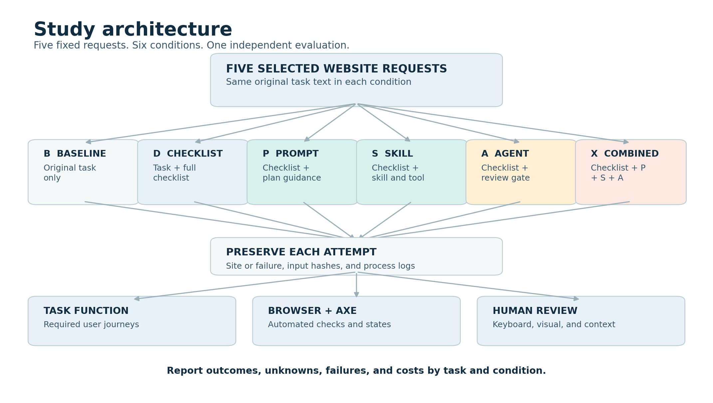
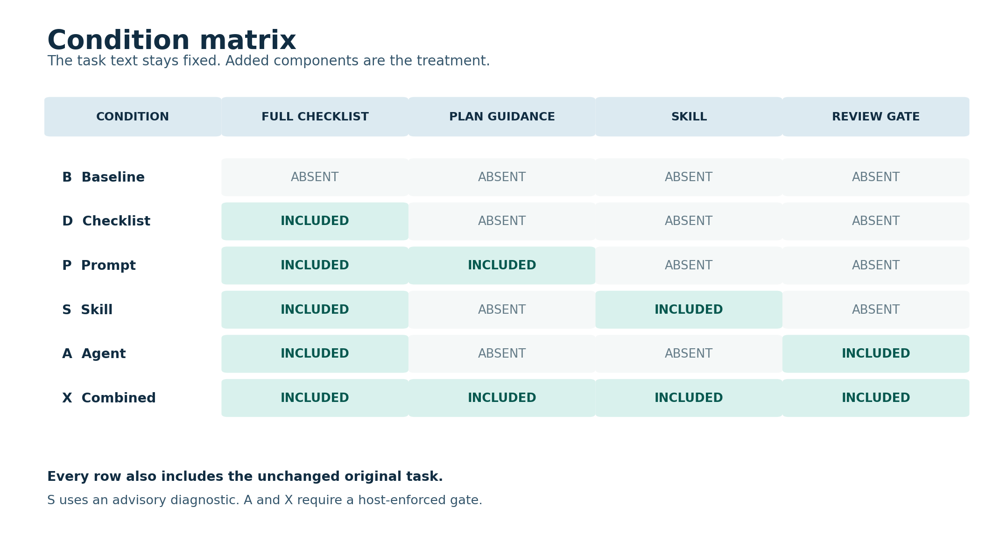
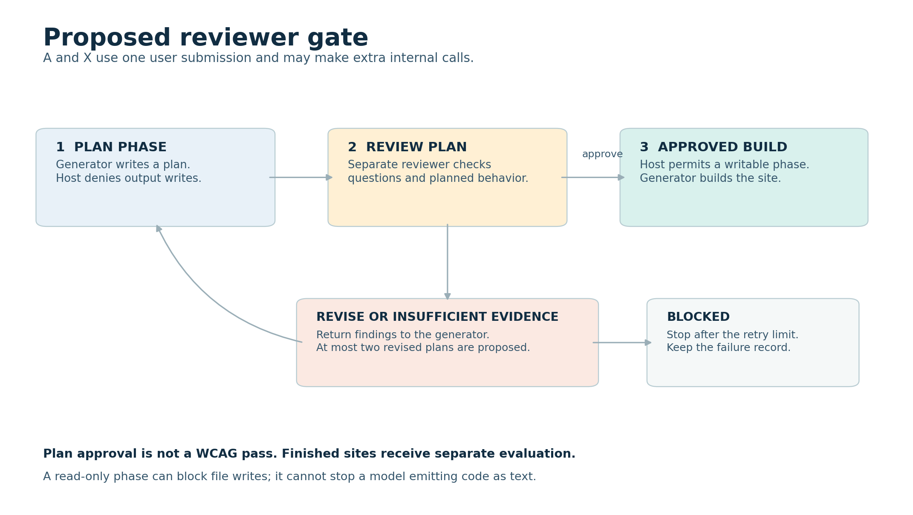

# Experiment plan: AI-generated website accessibility

**Version:** Draft 0.1, 30 October 2026.
**Status:** Proposal for discussion. No benchmark or participant study has run.
**Language:** ASD-STE100-oriented technical English. Formal conformance is not verified.

The original Arena tasks and full checklist retain their existing wording.
Their wording has not been checked against the ASD-STE100 dictionary.

## 1. Purpose and boundaries

This study asks whether specific interventions change accessibility in AI-generated websites.
It also measures website function, review behavior, and resource costs.
The five chosen requests remain the study tasks.
The task text must stay unchanged in every condition.
The study adds material in some conditions, so the full model inputs differ.

This is an exploratory study of five selected tasks.
It cannot prove that one method is best for all websites or AI systems.
The review may find no improvement or a worse result.
The team must report those outcomes as well.

**Important:** The Arena dataset terms require clarification before hosted-model submission or public release of prompt text.
See the [dataset agreement](https://huggingface.co/datasets/lmarena-ai/webdev-arena-preference-10k).
No original task text is reproduced in this protocol.

## 2. Research questions

| ID | Proposed question | Main comparison |
| --- | --- | --- |
| RQ1 | How do the packages affect the selected accessibility and task checks? | Each condition versus baseline B. |
| RQ2 | Does a package add value beyond the full checklist alone? | P, S, A, and X versus D. |
| RQ3 | What costs, failures, and process behaviors accompany each package? | All six conditions. |
| RQ4 | Do model checklist claims agree with independent observations? | D, P, S, A, and X only. |

**Proposed directional hypothesis:** X improves the task-and-accessibility success rate compared with D.
The opposite or no change remains possible.
All other comparisons are exploratory in this five-task design.
The team must accept the final outcome and analysis plan before study runs.

This experiment does not measure human automation bias.
No participant answers questions in the proposed autonomous version.
A human-overreliance claim requires a separate participant study.

## 3. Tasks

| Task | Selected shortlist item | Public description | Design concern |
| --- | ---: | --- | --- |
| T01 | 7 | Services landing page | The request refers to an order form that was not supplied. |
| T02 | 8 | Consulting landing page | The request already asks for contrast and semantic HTML. |
| T03 | 18 | Cinema listings and ticket selection | Film data and delivery services are not supplied. |
| T04 | 19 | Task dashboard with charts and drag-and-drop | The request needs several interactive functions. |
| T05 | 1 | Personal portfolio | The request is short and leaves features open. |

The selection was purposive.
It is not a random sample of website requests.
The original first user message is the task input.
The [task manifest](../../../benchmarks/selected_arena_baselines/manifest.json) records identifiers and UTF-8 hashes.
The exact task input must match its manifest hash at every run.

Before running, define a task contract for each request.
Record every required journey, supplied input, external dependency, and allowed fixture.
Treat an unavailable required input as unresolved until the team chooses a consistent rule.
Do not edit the source task or quietly invent a service.

## 4. The six proposed conditions

The checklist is the existing 188-item action checklist, version 0.1.0.
It has 81 WCAG-derived items, 81 guidance items, and 26 research-process items.
The checklist is a research draft; expert review is still needed.

| ID | Generator receives | Extra study mechanism | What the comparison can show |
| --- | --- | --- | --- |
| B | Original task only | None. | Baseline for the selected model and runner. |
| D | Original task plus the full checklist and self-report request. | Direct user-message guidance. | Effect of this complete checklist package versus B. |
| P | Same D message. | Persistent plan and question guidance. | Effect of this instruction package versus D. |
| S | Same D message. | Reusable skill and a plan diagnostic. | Effect of this skill package versus D. |
| A | Same D message. | Separate reviewer and host-enforced plan gate. | Effect of this reviewer workflow versus D. |
| X | Same D message. | P, S, and A together. | Effect of this specific combined package versus D. |

The packages change several things at once.
The result cannot isolate the value of packaging, extra time, or an individual instruction.
The six-arm design also cannot estimate all interactions between P, S, and A.
For that question, use all eight P/S/A combinations plus B: nine conditions total.

| Checklist-based factor combination | Present in six-arm proposal? |
| --- | --- |
| No P, S, or A: D | Yes. |
| P only | Yes. |
| S only | Yes. |
| A only | Yes. |
| P plus S | No. |
| P plus A | No. |
| S plus A | No. |
| P plus S plus A: X | Yes. |

Even the full factorial design needs enough independently sampled tasks for broader inference.
Five tasks and three repeats support a limited exploratory comparison.

P has no study-specific host gate.
S requests a diagnostic, but the host does not enforce a gate in S.
A and X use a host gate only when the runner supports the needed controls.
The runner must record actual activation and gate behavior.
An instruction file is not automatically a model system-role message.

## 5. Study size and independence

The initial proposal uses two model-and-runner configurations.
Codex and Antigravity are candidates, subject to availability and capability checks.
Record the actual model, runner, version, and settings for each run.
If a model or setting is hidden, record it as unknown.

The proposed budget is five tasks times two configurations times six conditions times three repeats.
That is **180 scheduled generation attempts**.
This number is a planning example, not a power calculation.
The nine-condition extension would require 270 attempts with the same two configurations and three repeats.

At the proposed 20-minute cap, 180 attempts could occupy up to 60 hours of sequential generation time.
That limit excludes setup and review.
As an illustration, 30 minutes of manual review per artifact would add 90 hours for 180 artifacts.
Actual review time and the number of runnable artifacts are unknown.
The team should check its budget before freezing the matrix.

One run is a fresh generation attempt for one task, configuration, condition, and repeat.
Repeats measure run variation for the same selected tasks.
They do not create 180 independent website requests.
Results must show each task and configuration separately.

## 6. SPV question policy

SPV means Socratic Plan Verification in this draft.
The autonomous version asks an AI to generate and answer plan questions.
For A and X, a separate reviewer inspects the plan before the host permits implementation.
This reviewer does not evaluate the finished site for the study outcome.

One-shot means one initial user submission for each run.
The agent workflow may make extra internal model calls.
Record those calls, all plan revisions, and their costs.
An AI answer is not evidence that a human reviewed the plan.

## 7. Proposed schedule

| Phase | Work | Exit condition |
| --- | --- | --- |
| 0 | Resolve task rights and researcher decisions. | Record authorization or replace the task source. |
| 1 | Write task contracts and assessment checks. | Review and freeze scope, fixture rules, and test specifications. |
| 2 | Build the four intervention packages. | Version each package and validate on separate development fixtures. |
| 3 | Build runners and independent evaluators. | Test adapters, gate failures, evidence capture, and reviewer agreement. |
| 4 | Freeze protocol and schedule. | Store hashes, tool versions, order, and stopping rules. |
| 5 | Execute every scheduled run. | Preserve every artifact or failure record. |
| 6 | Evaluate under masked labels. | Record function, accessibility, missing data, and costs. |
| 7 | Analyze and review release rights. | Publish only permitted material and supported findings. |

Detailed instructions appear in [02-prompt-pack.md](02-prompt-pack.md),
[03-evaluation.md](03-evaluation.md), and [04-build-and-run.md](04-build-and-run.md).
The source rationale appears in [05-evidence.md](05-evidence.md).

## 8. Decisions still required

- Confirm dataset rights and permitted sharing with each service.
- Choose the actual model-and-runner configurations after capability checks.
- Review the full checklist and the task-specific checks with an accessibility specialist.
- Confirm the budget, exact outcome, gate retry limit, and time cap before freezing.
- Decide whether a second independent reviewer and assistive-technology testing are available.
- Decide whether to add the three missing factorial combinations.
- Decide separately whether a human participant study is in scope.

The diagrams and prompts describe a proposed design.
They are not evidence of an implemented or validated system.
