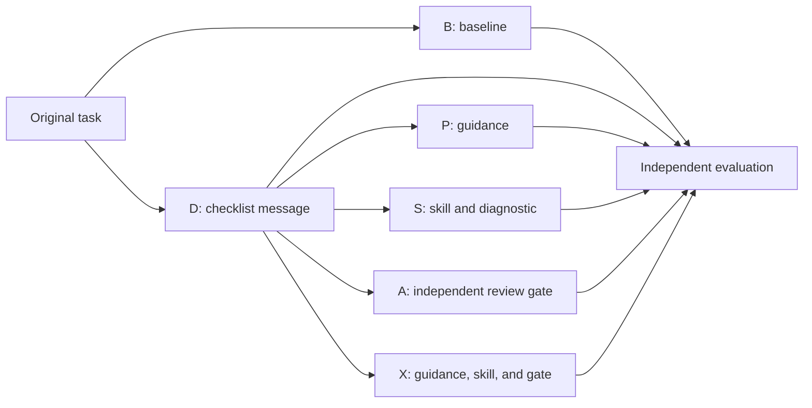

# Phase 6: combined development package

**Status:** Built as a development candidate, 30 October 2026.
Local tests cover the diagnostic, input assembly, and host callback order.
No live S, A, or X comparison has run with this package.
A Codex adapter has mock-process tests. Verified isolation, live integration, evaluation procedures, and protocol freeze remain open.

## Study conditions

| Condition | User message | Additional intervention |
| --- | --- | --- |
| B | Original task bytes only. | None. |
| D | Original task plus the shared instruction and approved checklist. | None. |
| P | The same D message. | Project or system-level plan guidance. |
| S | The same D message. | Accessibility skill and available advisory diagnostic. |
| A | The same D message. | Separate reviewer and a host-controlled build transition. |
| X | The same D message. | P, S, and A together. |

P has no host gate. S's diagnostic has no approval authority.
A and X use the same review gate. X includes one checklist and one gate.
Use fresh sessions and an isolated output folder for each actual attempt.
The user submits one initial task. A and X can make additional internal model calls.



For X, the host's planning restriction takes precedence over the guidance to implement after planning.
The skill can use the advisory diagnostic in the read-only phase if the runner permits it.
The host alone controls the build callback after an approved plan.
The independent evaluator reviews saved artifacts after generation.

## Exact input assembly

[prepare_condition.py](prepare_condition.py) prepares B, D, P, S, A, and X without calling a model.
It checks the selected task's expected SHA-256, the approved checklist, and the package manifest.
B returns the original task bytes.
D, P, S, A, and X return the same bytes assembled by the Phase 3 input preparer.
That message contains the common instruction and checklist exactly once.
The extra P, S, and A components use their designated runner channels.
Do not claim a project file is a system-role message unless the runner uses that role.

Use the API to pass the returned bytes to an adapter.
The command-line form prints hashes and metadata only:

```powershell
python research/phased-study/phase-06/prepare_condition.py --task-file <local-task-file> --expected-task-sha256 <sha256> --condition X
```

Use [check_selected_inputs.py](check_selected_inputs.py) to check the five selected local tasks.
It prints IDs and hashes, not original prompt text.
It makes no model call.
The [verification record](verification-2026-10-30.md) describes the completed offline checks.

The [package manifest](package-manifest.json) records the development files and their SHA-256 hashes.
It is an integrity aid, not a preregistration or independent signature.
If a file changes, review the change and issue a new manifest before use.
Record the manifest hash and the exact runner configuration with each attempt.
Keep source tasks, transcripts, traces, and generated websites in private local storage.

## How to connect a real runner

1. Verify the platform's instruction and skill-loading mechanisms.
2. Make a separate model session for review in A and X.
3. Implement planner, reviewer, and builder adapters for that platform.
4. Confirm that planning and review cannot write to the build workspace.
5. Connect the skill diagnostic as a function or a permitted shell tool in S and X.
6. Preserve exact inputs, channel names, model and runner versions, tool calls, decisions, timings, errors, and artifacts.
7. Test these controls with separate synthetic fixtures before the selected tasks.
8. Record unsupported or unverified capabilities rather than treating them as active.

The [Codex adapter](run_codex_review.py) supports S, A, and X as a development integration.
It provisions the skill for S and X, and creates separate planning and review CLI sessions for A and X.
Its mock tests check command construction, distinct thread records, and callback order.
They do not establish that a real Codex session loads the skill or honors the requested boundary.
No Gemini, Antigravity, or Claude adapter is supplied by this package.
The OpenAI function example has structural checks only.
Host integration must record actual skill activation and use of the diagnostic.
It must persist trace events during a run, including an interruption or timeout.
The generic gate returns its trace in memory after it finishes.
The Codex adapter also records individual calls and CLI event logs in private local storage.

### Codex preflight

The adapter refuses its command-line run without an isolation evidence record.
The [preflight template](isolation-preflight-template.json) starts with every check unverified.
Do not change a value to `true` without observing that check and retaining the evidence.
The adapter checks the stated result and Codex version. It cannot prove that an attestation is true.

Verify blocked writes during planning and review, including alternate tools and the output workspace.
Verify that all phases cannot read research records, prior outputs, selected-task files, or evaluator answers.
Verify the instruction sources and separate session identities.
The CLI's `read-only` setting alone does not establish these read boundaries.
Use an external isolation environment when the runner cannot provide them.
Record the effective network policy and any inaccessible dependencies.
The earlier B, D, and P runner used a different sandbox profile.
Standardize or explicitly account for environment differences before a final comparison.

After a valid preflight, the adapter accepts S, A, or X, a selected task ID, and a unique run ID.
It records requested model and reasoning settings, input hashes, CLI events, and status.
It uses a fresh CLI session for each internal call.
Each call includes the actual thread ID. A repeated thread is rejected.
The adapter requests skill discovery; actual activation remains `unknown` until logs establish it.
The adapter's build workspace is a generated artifact only after independent build and task checks.
No real Codex call has been made with this adapter.

## Evaluation and scientific interpretation

The draft [evaluation plan](../../experiment-protocol-2026-10-30/03-evaluation.md) specifies the independent human and Playwright/axe layers.
It defines task completion, scoped demonstrated success, observed failures, unknowns, axe impact, and resource measures.
Freeze the exact task contracts, states, procedures, and classification rules before the final batch.
Keep failed, blocked, and indeterminate attempts in the denominator under the chosen rules.
Do not convert an unassessed check into a pass.
Report axe impacts as tool classifications, not WCAG severity levels.
The [W3C evaluation overview](https://www.w3.org/WAI/test-evaluate/) describes evaluation methods and limitations.

Compare B with D, then each P, S, A, and X package with D.
Report each task and model-runner combination, all attempts, and resources.
The packages differ in instructions, channels, tool calls, and model calls.
These comparisons do not isolate the effect of each component inside a package.
Pairwise combinations are needed to study interaction effects.
Five purposively selected tasks cannot establish a universally best method.
This design does not measure human comprehension or automation bias.

## Next work before site generation

- Integrate and preflight the selected real runners.
- Review the intervention wording and checklist with an accessibility specialist when available.
- Freeze the feature contracts, fixtures, evaluation procedures, and retry policy.
- Run a separate practice task and resolve integration failures.
- Freeze and record the final package and protocol before the comparative batch.
- Start fresh model sessions for the selected tasks and preserve all outcomes.

The researcher elected to proceed past Phase 3.
Earlier exploratory build and review gaps remain documented in the Phase 3 records.
